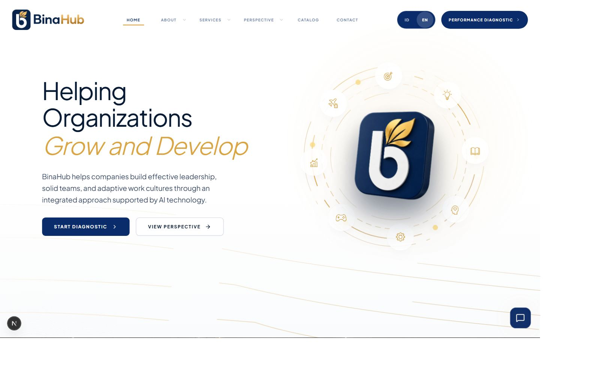
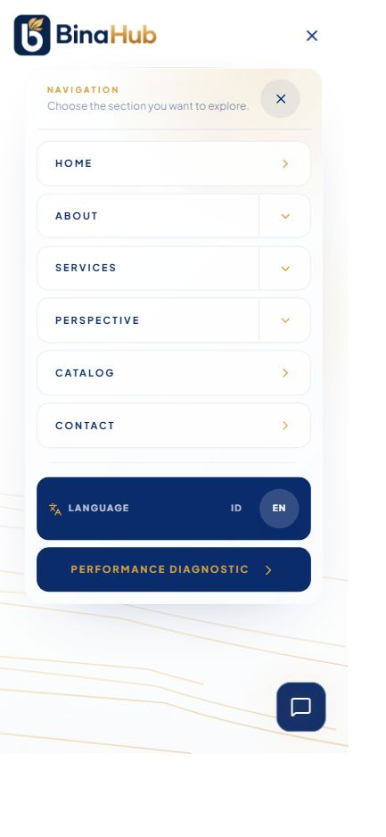

# Hasil refinement UI Binahub

14 Oktober 2026. Mengikuti pilihan pengguna: temuan 1, temuan 2, lalu pemeriksaan relevan dari audit awal. Dokumen ini mencatat hasil verifikasi lokal sebelum commit dan push; deployment belum diverifikasi.

## Perubahan

| Area | Hasil | Pemilik implementasi |
| --- | --- | --- |
| Temuan 1: bahasa mobile | Label Bahasa/Language dan nama grup aksesibel mengikuti locale. Tombol pilihan bahasa memiliki area sentuh 44px. | `src/components/layout/language-switcher.tsx` |
| Temuan 2: kursor kartu | Menghapus penunjuk tangan pada kartu layanan informatif. Browser mengembalikan cursor `auto`. | `src/components/stacking-service-cards.tsx` |
| Tipografi carousel | Menggunakan font utama Plus Jakarta Sans yang sudah dimuat, menggantikan referensi Poppins yang tidak dimuat. Paragraf berfont sekunder tetap menggunakan sistem yang ada. | `src/app/_sections/about-carousel-section.tsx` |
| Hero responsif | Kolom dapat menyusut tanpa min-content overflow; heading dapat membungkus kata; CTA dapat berpindah baris. Orbit mengikuti lebar kontainernya, dan pusat ikon dikoreksi. Nama aksesibel heading dibaca sebagai kalimat utuh. | `src/app/_sections/hero-section.tsx`, `src/app/globals.css` |
| Navbar responsif | Navigasi penuh tampil mulai 1440px, saat ruang tersedia. Di bawahnya memakai menu kompak yang sudah ada. Aturan penyusutan desktop tidak lagi menyembunyikan logo dan pembuka menu setelah scroll mobile. | `src/components/layout/navbar.tsx` |
| Keyboard dan kontrol | Submenu desktop memiliki tombol disclosure; Enter membuka dan Escape menutup serta mengembalikan fokus. Menu mobile memiliki nama, expanded state, hubungan kontrol, dan Escape. Focus ring memakai aksen gold. Tombol misi dilokalkan; indikator slide memiliki hit area 44px dan pressed state. | Navbar, carousel, `src/app/globals.css` |
| Carousel | Dapat dijeda; pemilihan slide manual menghentikan autoplay sampai pengguna memilih putar. Autoplay berhenti saat hover, fokus, di luar viewport, tab tersembunyi, atau reduced motion. Tinggi area konten dapat bertambah sesuai teks. | `src/app/_sections/about-carousel-section.tsx` |
| Reduced motion | Intro dilewati; heading/CTA langsung terlihat; tilt dan smooth scroll nonesensial dihentikan. Carousel berganti tanpa gerakan. HUMAN menampilkan lima nilai sebagai daftar statis yang terbaca, dan kartu layanan menjadi daftar tanpa efek tumpukan. Mode normal tetap mempertahankan animasi yang ada. | `src/hooks/use-reduced-motion.ts`, intro, hero, carousel, HUMAN, kartu layanan, navbar, CSS |
| Performa kartu | Semua pembacaan posisi dilakukan sebelum pembaruan state. Masing-masing kartu diukur satu kali per frame; event beruntun digabung ke frame yang sama. State tidak diganti jika depth tetap sama. `will-change` permanen dihapus, listener resize ditambahkan, dan frame dibatalkan saat cleanup. | `src/components/stacking-service-cards.tsx` |

Warna navy/gold, aset, logo 3D, ilustrasi, isi layanan, dan keluarga font yang sudah menjadi identitas Binahub tetap menjadi acuan. Tidak ada dependency baru atau migrasi library. Navbar adalah komponen bersama sehingga perbaikannya diwarisi route publik lain; pemeriksaan browser terfokus pada beranda.

## Bukti dan validasi

- `npm run quality:public`: lulus ESLint dan TypeScript pada source final.
- `npx eslint src/hooks/use-reduced-motion.ts`: lulus; hook diperiksa tersendiri karena path hooks tidak tercakup lint publik.
- `npm run build`: lulus; 42 halaman statis berhasil dihasilkan.
- `git diff --check`: lulus.
- Pengujian depth delapan kartu: seluruh 256 kombinasi status sticky menghasilkan depth identik dengan algoritma sebelumnya. Jumlah pembacaan layout per frame berkurang dari maksimum 28 menjadi 8. Ini adalah pengurangan operasi yang terverifikasi, bukan klaim peningkatan FPS atau Core Web Vitals.
- Hook reduced motion diuji dengan React `renderToString` tanpa global `window`: berhasil. `useSyncExternalStore` menggunakan snapshot server yang stabil dan berlangganan perubahan preferensi di browser.
- Browser Chrome lokal: ID/EN pada lebar CSS 390, 768, 1024, dan 1440px diperiksa. `document.documentElement.scrollWidth` sama dengan lebar viewport pada pengukuran tersebut. Heading tidak melebihi lebar kolomnya setelah perbaikan; pembulatan subpixel dapat menghasilkan selisih kurang dari 1px pada `scrollWidth`.
- Browser mengonfirmasi label mobile EN Language, route berganti locale, tombol Escape mobile mengembalikan fokus ke Open menu, Enter desktop membuka submenu, Escape desktop mengembalikan fokus ke tombol submenu, dan outline fokus berupa solid.
- Sesudah scroll mobile, tombol pembuka menu masih terlihat dan ancestor opacity bernilai 1. Kartu layanan memiliki cursor `auto`. Tombol carousel/misi terukur sekitar 44×44 CSS px.
- Pergantian misi ke Adaptive Leadership & Future Readiness terkonfirmasi dari kartu aktif. Pemilihan slide mengubah pressed state serta kontrol menjadi Play slideshow/Putar pergantian slide.
- Pembacaan console error pada tab pengujian mengembalikan daftar kosong.
- Build produksi dijalankan melalui `npm run start` pada `http://127.0.0.1:3011/`. Menu EN dibuka kembali dan label Language dikonfirmasi pada build tersebut; screenshot mobile disimpan setelah konten selesai dirender.

## Detector dan batas pemeriksaan

Impeccable detector dijalankan satu kali terhadap file UI terkait. Hasil mentah: [binahub-ui-detector.json](binahub-ui-detector.json). Detector mengembalikan satu peringatan `side-tab` untuk `.pixel-start-btn` di stylesheet lama. Selector tersebut tidak ditemukan dipakai oleh source komponen yang ditelusuri dan tidak diubah dalam refinement ini; tidak dijadikan alasan menghapus gaya di luar scope.

Pemeriksaan terbatas pada emulasi ukuran di Chrome dan interaksi pointer/keyboard. Perangkat sentuh fisik, zoom browser 200%, browser lain, dan pergantian preferensi reduced motion melalui pengaturan OS belum diuji secara langsung. Cabang reduced motion telah diperiksa melalui source, typecheck, dan pengujian render server; hasil visual mode tersebut masih memerlukan konfirmasi pada perangkat dengan preferensi aktif.

Log development juga menunjukkan peringatan lama mengenai scroll container, atribut `data-scroll-behavior` Next.js, dan prioritas gambar logo. Hal-hal tersebut tidak memblokir build. Tidak ada pengujian backend, form produksi, pengiriman pesan, atau deployment pada tahap ini.

## Preview

